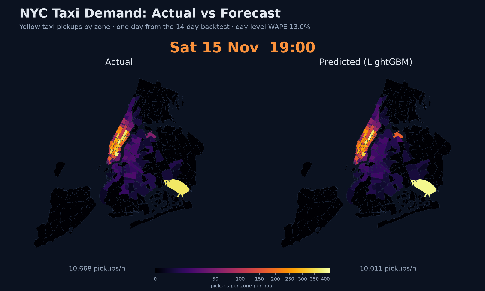

# 🚕 NYC Taxi Demand Forecaster

Hourly NYC yellow taxi pickup forecasts for 120 zones using LightGBM, with an animated actual-vs-predicted city map.



Animation: [`outputs/taxi_forecast.mp4`](outputs/taxi_forecast.mp4)

## Results

Backtest on 14 held-out days (3 to 16 Nov 2025), 120 zones, hourly:

| Model | WAPE |
|---|---|
| **LightGBM (this project)** | **16.0%** |
| Same hour last week | 20.5% |
| Same hour yesterday | 28.9% |

About 22% better than the strongest naive baseline. WAPE is total absolute error divided by total pickups, used instead of MAPE because many zones have zero pickups in quiet hours.

## How it works

- **Data:** about 49 million yellow taxi trips from 2025 (NYC TLC), aggregated to pickups per zone per hour, plus hourly weather from Open-Meteo.
- **Model:** LightGBM with a Poisson objective. Each zone's recent weekly level enters as an offset, so the model learns only the ratio on top of it.
- **Features:** zone, hour, weekday, month, holiday, temperature, rain, wind, humidity, and lags at 24 and 168 hours.
- **Visual:** a matplotlib animation of actual vs predicted pickups across the city for the busiest day of the backtest.

## Limitations

Trained on a single year, so holiday weeks (for example Christmas to New Year) are a known weakness; the backtest window deliberately avoids them.

## Run it

Data: https://www.nyc.gov/site/tlc/about/tlc-trip-record-data.page (yellow taxi 2025 files into `data/raw/`, zone shapefile into `data/zones/`).

```
pip install -r requirements.txt
python prep_data.py
python train.py
python video.py
```